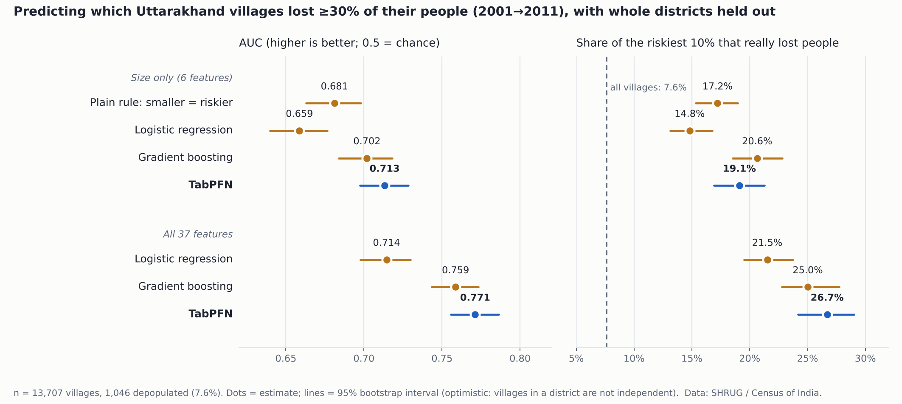

# The Villages That Went Quiet

**Can the 2001 census tell us which Uttarakhand villages lost most of their people by 2011?**

An experiment for the DEV Hacktoberfest Open-Source AI Challenge, Week 4 (*Ghost in the Machine*).
Full write-up: [`results/post.md`](results/post.md).

## Result in one table

Whole districts are held out (5 folds over 13 districts). Intervals are 95% bootstrap intervals and are optimistic.

| Model | Features | AUC | Hit rate, riskiest 10% |
|---|---|---|---|
| Plain rule: smaller = riskier | population | 0.681 | 17.2% |
| Logistic regression | 6 (size) | 0.659 | 14.8% |
| Gradient boosting | 6 (size) | 0.702 | 20.6% |
| **TabPFN** | 6 (size) | 0.713 | 19.1% |
| Logistic regression | 37 (all) | 0.714 | 21.5% |
| Gradient boosting | 37 (all) | 0.759 | 25.0% |
| **TabPFN** | 37 (all) | **0.771** | **26.7%** |

The base rate is 7.6%. TabPFN and gradient boosting are within noise of each other on all 37 features (0.012 AUC apart, intervals overlap; no paired test was run).
Adding the 31 extra features raised TabPFN's AUC from 0.713 to 0.771. In an ablation, census shares (age, work, literacy) added more than amenities (+0.047 vs +0.019 AUC).

## What is in the data

- **13,707** Uttarakhand villages with at least 50 people in 2001 (6.2 million people).
- **Label (fixed before scoring):** depopulated = 2011 population below 70% of 2001, **or** no 2011 record. 1,046 villages (7.6%); 64 of them have no 2011 record and may be merges or renames.
- **Features:** 2001 only. SIZE = 6 (log population, land area, density, sub-district averages). FULL = 37 (SIZE + 19 village-directory amenities + 12 census shares).
- Source: SHRUG 2.2 (Development Data Lab), built on the Census of India. Data ends at 2011; the 2021 census was not conducted.

## Repository map

| Path | What it does |
|---|---|
| `cut_uk.py`, `cut_by_shrid.py` | Cut the big SHRUG files down to Uttarakhand (state code 05) |
| `build_and_baselines.py` | Joins 2001 and 2011, applies the label, builds size features and folds, scores baselines |
| `build_v2.py` | Adds amenities and census shares, scores logistic regression and gradient boosting, permutation importance |
| `ablation.py` | Which feature group adds signal |
| `run_tabpfn_v2.py` | Runs TabPFN on both feature sets with the same folds |
| `make_chart.py` | Draws the figure from the result files (no hand-typed numbers) |
| `data/uk_villages_v2_slim.csv` | The derived table (village codes, label, folds, 37 features) |
| `results/` | Result JSON files, the chart and the post |

## Reproduce

1. Download SHRUG 2.2 from <https://www.devdatalab.org/shrug>: **Core keys** (Population Census keys) and **Population Census** (2001 Population Census Abstract, 2001 Village Directory), `.dta` format.
2. Cut to Uttarakhand: `python cut_uk.py` then `python cut_by_shrid.py` (run in the download folder).
3. Build and score baselines: `python build_v2.py <keys_dir> <pca01.csv> <vd01.csv> <out_dir>`
4. Ablation: `python ablation.py <out_dir>/uk_villages_v2.csv`
5. TabPFN: `pip install tabpfn`, accept the license at <https://platform.priorlabs.ai/account/licenses>, set `TABPFN_TOKEN` to your API key (**never commit it**), then `python run_tabpfn_v2.py data/uk_villages_v2_slim.csv`
6. Chart: `python make_chart.py results/results_v2_baselines.json results/tabpfn_results.json results/quiet_villages_results.png`

Needs Python 3.10+, pandas, numpy, scikit-learn, matplotlib. TabPFN ran on Colab in about three minutes (10 fits).

## Limits, stated plainly

- **Associations, not causes.** Small villages also lack roads and schools; this cannot say a road would have kept anyone.
- **Only Uttarakhand, only rural villages, only 13 districts.** Nothing here says it holds elsewhere.
- **Intervals are optimistic:** villages within a district are not independent.
- **Merged units:** SHRUG units merge villages where boundaries changed, so one unit can hide a single village emptying.
- **Completely empty villages** appear to be missing from the 2011 table, so the label cannot see all of them.
- **No ranked list of villages is published, on purpose.** Among the riskiest 10% by the best model, about three in four did not lose people. A list would be wrong about most of its names and would label places where people live.

## Licenses and credits

- Code: MIT (`LICENSE`).
- Derived data in `data/`: **CC BY-NC-SA 4.0**, as SHRUG requires (non-commercial, attribution, share-alike).
- Data: Asher, Lunt, Matsuura and Novosad (2021), *Development research at high geographic resolution: an analysis of night-lights, firms, and poverty in India using the SHRUG open data platform*, World Bank Economic Review 35(4). Census of India, Office of the Registrar General & Census Commissioner, via SHRUG 2.2.
- TabPFN: Prior Labs, used under its license (free for non-commercial use after accepting the license).
